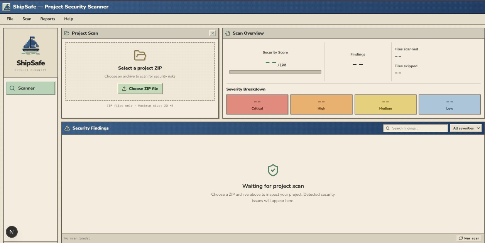
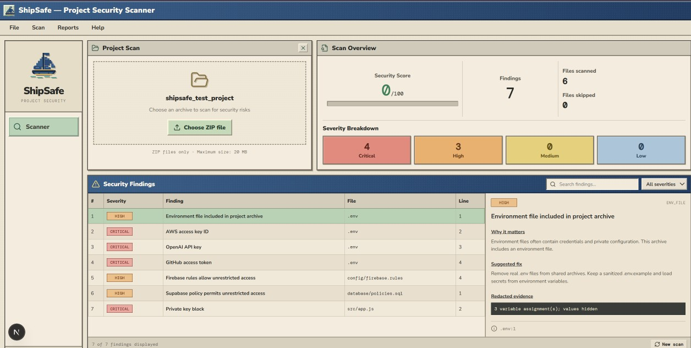

#  ShipSafe — Static Project Security Scanner
Modern software projects often contain sensitive information and security weaknesses that developers may overlook while building or preparing their applications for sharing.

Exposed API keys, hardcoded database credentials, insecure configurations, and unsafe code patterns can create security risks if they make their way into a shared repository or deployment.

I built ShipSafe to explore how these issues could be identified early through an accessible, automated security-checking tool.

The goal was to create a simple way for developers to upload a project archive, scan its files for common security issues, and understand what needs attention through clear explanations and suggested fixes.

Through this project, I also wanted to gain practical experience with secure file handling, static code analysis, backend API development, and building a user-friendly security dashboard.

##  Features

- **ZIP-based scanning:** Upload software project archives for analysis.
- **Secret detection:** Identifies potential exposure of API keys, database credentials, authentication secrets, and private keys.
- **Code vulnerability detection:** Checks for potentially unsafe SQL queries, command injection, and dynamic code execution.
- **Configuration checks:** Detects issues such as wildcard CORS, insecure HTTP requests, and unsafe cookie configurations.
- **Security scoring:** Generates a preliminary security score based on detected findings.
- **Actionable findings:** Displays severity, affected file, line number, explanation, and suggested remediation.
- **Evidence redaction:** Hides sensitive values in displayed findings.
- **Archive safety checks:** Applies limits and validation to uploaded ZIP archives.
## 📸 Screenshots

### ShipSafe Dashboard


### Security Scan Results

## The Tech Stack

- Next.js
- React
- TypeScript
- Node.js
- CSS

##  Getting Started

### Prerequisites
- Node.js
- npm

### Installation

1. Clone the repository:

   ```bash
   git clone https://github.com/pragya-bansal/shipsafe.git
   ```

2. Navigate into the project:

   ```bash
   cd shipsafe
   ```

3. Install dependencies:

   ```bash
   npm install
   ```

4. Start the development server:

   ```bash
   npm run dev
   ```

5. Open [http://localhost:3000](http://localhost:3000) in your browser.

## How It Works

1. Upload a ZIP archive containing a software project.
2. ShipSafe validates the archive and filters files for scanning.
3. Static detection rules inspect eligible files for potential security issues.
4. Findings are categorized by severity.
5. The dashboard displays the security score, affected files, evidence, and suggested fixes.

## ⚠️ Limitations

ShipSafe uses rule-based static analysis. It does not execute uploaded code or perform dynamic application testing or penetration testing.

Its findings are preliminary indicators and may include false positives or miss vulnerabilities. A high security score does not guarantee that a project is secure.

##  Author

**Pragya Bansal**

GitHub: [@pragya-bansal](https://github.com/pragya-bansal)
